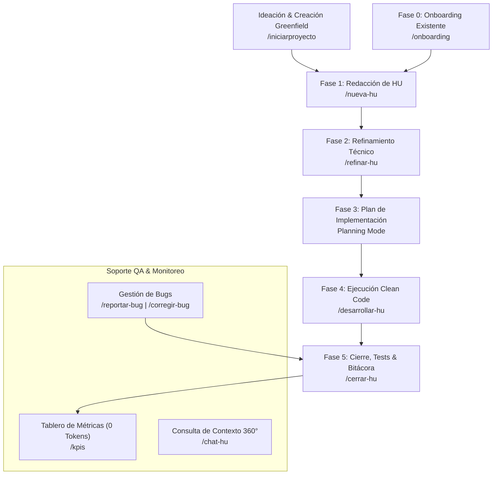

# 🚀 Skill Auto Management: Metodología AI-First Multi-Asistente (Multilenguaje)

[](#)
[](#)
[](#)
[](#)
[](#)

> [!NOTE]
> **Skill Auto Management** es una solución integral y estandarizada que automatiza la metodología ágil **Scrum AI-First** en cualquier proyecto de software (.NET C#, Java Spring Boot, TypeScript/Node/Angular/React, Go, Rust, PHP, Python, etc.).
> 
> Permite a desarrolladores y Agentes IA trabajar coordinadamente generando documentación viva en `automanagement_docs/`, refinamientos con contratos DTOs, desarrollo **Clean Code sin comentarios redundantes**, pruebas automatizadas con Coverage Gates y tableros de KPIs con **0 consumo de tokens de API**.

---

## 💡 ¿Cómo Funciona la Metodología?

La metodología opera bajo el principio de **Single Source of Truth** (Fuente Única de Verdad). Todo el conocimiento del proyecto reside en artefactos Markdown dentro de la carpeta centralizada `automanagement_docs/` en la raíz del repositorio.



---

## 👥 Roles Activados y Responsabilidades

La skill asigna automáticamente roles especializados según el comando ejecutado:

| Rol Asistente | Fase Scrum | Responsabilidad Principal | Artefacto Generado / Auditado |
|---|---|---|---|
| 🏛️ **`CTO / TechAdvisor`** | Greenfield | Calibra perfil técnico/negocio, valida herramientas de entorno, orquesta CLIs oficiales e inicializa base de conocimiento. | `automanagement_docs/base-conocimiento/`<br>Estructura base del framework |
| 👷 **`TechLeadArchitect`** | Fase 0 & Fase 2 | Escanea la arquitectura del proyecto y modela contratos DTOs, flujos Mermaid y checklists de desarrollo. | `automanagement_docs/base-conocimiento/`<br>`automanagement_docs/refinamientos/REF-XXX.md` |
| 📋 **`POScrum`** | Fase 1 & QA Bugs | Captura requerimientos bajo la **Regla Anti-Alucinación** y define criterios de aceptación en formato Gherkin. | `automanagement_docs/hus/HU-XXX.md`<br>`automanagement_docs/bugs/BUG-XXX.md` |
| 💻 **`DevQA`** | Fase 4 & Fase 5 | Desarrolla código auto-descriptivo (**0 comentarios explicativos**), ejecuta tests desatendidos y audita Clean Code. | `automanagement_docs/dev-records/DEV-RECORD-HU-XXX.md`<br>`automanagement_docs/README.md` |

---

## ⚡ Matriz de Slash Commands por Asistente

Puedes usar los slash commands nativamente en **Google Antigravity**, **Claude Code CLI** o **GitHub Copilot**:

| Slash Command | Rol Activado | Fase | Acción que Ejecuta en el Proyecto |
|---|---|---|---|
| `/iniciarproyecto` | `CTO / TechAdvisor` | Greenfield | Ideación, calibración de perfil, verificación de entorno, CLI oficial e inicio de base de conocimiento. |
| `/onboarding` | `TechLeadArchitect` | Fase 0 | Escanea el proyecto con `onboard_project.py` y genera `automanagement_docs/base-conocimiento/`. |
| `/nueva-hu [ID]` | `POScrum` | Fase 1 | Redacta la Historia de Usuario en `automanagement_docs/hus/HU-XXX.md` en formato Gherkin. |
| `/refinar-hu [ID]` | `TechLeadArchitect` | Fase 2 | Diseña diagramas Mermaid, modelos DTO y checklist en `automanagement_docs/refinamientos/REF-XXX.md`. |
| `/desarrollar-hu [ID]` | `DevQA` | Fase 4 | Guía el desarrollo multilenguaje bajo Clean Code estricto sin comentarios redundantes. |
| `/cerrar-hu [ID]` | `DevQA` | Fase 5 | Audita comentarios con `validate_clean_code.py`, corre la suite de pruebas y genera la bitácora. |
| `/reportar-bug` | `POScrum` / `DevQA` | QA | Registra formalmente un defecto con severidad y RCA en `automanagement_docs/bugs/BUG-XXX.md`. |
| `/corregir-bug [ID]` | `DevQA` | QA | Exige un **Regression Test Gate** antes de solucionar el bug y marcarlo como `[Resuelto]`. |
| `/kpis` o `/metricas` | Todos | Monitoreo | Ejecuta `show_metrics.py` y muestra el dashboard en 0.02s con **0 tokens de IA**. |
| `/chat-hu [ID]` | Especialista 360° | Consulta | Inspecciona la tríada documental (`HU-XXX.md`, `REF-XXX.md`, `DEV-RECORD-HU-XXX.md`) y el código. |

---

## 📖 Guía Paso a Paso con Ejemplo Práctico (Walkthrough End-to-End)

A continuación se ilustra un ejemplo real de cómo utilizar la skill desde el primer día en tu proyecto:

### Paso 0: Creación de Proyecto desde Cero (Greenfield - `/iniciarproyecto`)
Si inicias un nuevo desarrollo, el `CTO / TechAdvisor` calibra tu perfil, verifica tu entorno y arranca el framework:

```text
Usuario: /iniciarproyecto
```

> **Resultado**: El agente calibra en 1 mensaje tu perfil ([1] Negocio / [2] Técnico), idea y ruta destino. Valida tus dependencias locales (`node`, `dotnet`, `python`, etc.), ejecuta el CLI oficial del framework (ej. `npx @nestjs/cli`, `dotnet new`) y crea `automanagement_docs/base-conocimiento/` para pasar directo a `/nueva-hu HU-001`.

---

### Paso 1: Onboarding Técnico de Proyecto Existente (Fase 0)
El Líder Técnico ejecuta el descubrimiento inicial de un repositorio ya existente:

```text
Usuario: /onboarding /ruta/a/mi-proyecto
```

> **Resultado**: El agente analiza el código fuente, detecta el stack (ej. Python/FastAPI, C# .NET o TypeScript) y genera los 4 documentos base en `automanagement_docs/base-conocimiento/`:
> - `01-analisis-arquitectura.md` (Diagramas de capas)
> - `02-estandares-desarrollo.md` (Convenciones)
> - `03-estandares-pruebas.md` (Coverage Gates)
> - `04-dominio-negocio.md` (Entidades y reglas)

---

### Paso 2: Creación de una Nueva Historia de Usuario (Fase 1)
El Product Owner define una nueva funcionalidad:

```text
Usuario: /nueva-hu HU-001 "Autenticación de Usuarios con JWT"
```

> **Regla Anti-Alucinación**: Si no adjuntas detalles, el agente te solicitará el objetivo, el rol (*Como...*) y los criterios. Con la información confirmada, crea `automanagement_docs/hus/HU-001.md` con escenarios **Gherkin** (*Dado / Cuando / Entonces*).

---

### Paso 3: Refinamiento Técnico y Contratos (Fase 2)
El Líder Técnico especifica la solución antes de escribir código:

```text
Usuario: /refinar-hu HU-001
```

> **Resultado**: Genera `automanagement_docs/refinamientos/REF-001.md` conteniendo:
> - Diagrama de secuencia Mermaid.
> - Modelos DTOs en el lenguaje del proyecto (.NET Records, Java POJOs, TS Interfaces, Python Dataclasses).
> - Checklist técnico para el desarrollador.
> - Actualización del estado a `[Aprobado para Desarrollo]`.

---

### Paso 4: Desarrollo Clean Code Multilenguaje (Fase 4)
El desarrollador o el agente implementan la funcionalidad:

```text
Usuario: /desarrollar-hu HU-001
```

> **Regla Clean Code**: Código 100% auto-descriptivo. **Cero comentarios explicativos redundantes** (`// Este método calcula el total` o `# Guarda el usuario`). Las pruebas se escriben bajo el patrón **AAA** (Arrange-Act-Assert) y **Data Builders**.

---

### Paso 5: Cierre, Tests y Bitácora de QA (Fase 5)
Una vez finalizada la codificación, se procede al cierre formal:

```text
Usuario: /cerrar-hu HU-001
```

> **Resultado**: 
> 1. Ejecuta la suite de pruebas desatendida (`dotnet test`, `mvn test`, `npm test`, `pytest`).
> 2. Ejecuta `validate_clean_code.py` para asegurar 0 comentarios redundantes.
> 3. Genera la bitácora `automanagement_docs/dev-records/DEV-RECORD-HU-001.md`.
> 4. Marca la HU como `[Finalizado]` en `automanagement_docs/README.md`.

---

### Paso 6: Monitoreo y Tablero de KPIs
En cualquier momento puedes consultar el estado general del proyecto:

```text
Usuario: /kpis
```

```text
======================================================================
               TABLERO DE METRICAS SCRUM AI-FIRST
======================================================================
 Historias de Usuario (HUs):
   - Creadas:     1
   - Completadas: 1 (100.0%)

 Defectos y Calidad (Bugs):
   - Reportados:  0
   - Resueltos:   0 (0.0%)

 Calidad de Codigo & Clean Code:
   - Auditorias realizadas: 1
   - Comentarios eliminados: 0

 Pruebas & Cobertura:
   - Cobertura Backend: 85.0% (Gate >= 80%: OK)
======================================================================
 [INFO] Tiempo de calculo: 0.02s | Consumo de tokens: 0.00
```

---

## 🛠️ Instalación y Configuración Rápida

El instalador automatizado `install.py` configura tu entorno en un solo paso:

### Opción A: Instalación Global (Google Antigravity + Claude Code)
Instala la skill de forma global para que esté disponible en cualquier conversación o directorio de tu máquina:

#### En Linux / macOS
```bash
python3 install.py
```

#### En Windows
```cmd
python install.py
```
*(O doble clic en `install.bat`)*

---

### Opción B: Configuración por Proyecto (GitHub Copilot / Workspace Local)
Si utilizas **GitHub Copilot** en VS Code o JetBrains, configura las directrices dentro de tu repositorio objetivo:

```bash
python3 install.py --workspace /ruta/a/tu-proyecto
```

---

## 📂 Estructura del Repositorio

```text
skill_auto_management/
├── SKILL.md                            # Entrada nativa para Google Antigravity (YAML Frontmatter)
├── CLAUDE.md                           # Directivas operativas para Claude Code / Claude CLI
├── README.md                           # Guía de uso principal del repositorio
├── install.py / install.sh / install.bat# Instaladores global y por workspace
├── .github/
│   ├── copilot-instructions.md         # Configuración para GitHub Copilot
│   └── prompts/                        # Prompts reusables (.prompt.md) para Copilot
├── .claude/
│   └── commands/                       # Slash commands nativos para Claude CLI (ej. /iniciarproyecto)
├── templates/                          # Plantillas Markdown estandarizadas
│   ├── base-conocimiento/              # Plantillas para Onboarding (Fase 0)
│   ├── hu-template.md                  # Plantilla de HU (Gherkin)
│   ├── refinamiento-template.md        # Plantilla de Refinamiento con Mermaid
│   ├── dev-record-template.md          # Plantilla para Bitácora Dev/QA
│   └── bug-template.md                 # Plantilla para Reporte de Defectos
├── references/                         # Guías metodológicas
│   ├── ai-first-scrum-workflow.md      # Flujo de trabajo en 5 fases y roles
│   ├── clean-code-rules.md             # Guía de código auto-descriptivo multilenguaje
│   └── testing-standards.md            # Coverage Gates y comandos headless
├── scripts/                            # Herramientas CLI en Python (Std-lib)
│   ├── onboard_project.py              # Onboarding técnico (Fase 0)
│   ├── scaffold_hu.py                  # Generador de HUs (Fase 1)
│   ├── scaffold_bug.py                 # Generador de Bugs (QA)
│   ├── show_metrics.py                 # Dashboard de KPIs en 0.02s
│   └── validate_clean_code.py          # Auditor de Clean Code multilenguaje
└── tests/                              # Suite de pruebas unitarias de la CLI
    └── test_scripts.py
```

---

## 🔒 Directrices Inmutables de Calidad
1. **Código Auto-Descriptivo**: Nombres intencionados en clases y métodos. 0 comentarios explicativos redundantes.
2. **Pruebas Automatizadas**: Mínimo 80% de cobertura en Backend/CLI y 85% en Frontend.
3. **Persistencia Centralizada**: La carpeta `automanagement_docs/` reside exclusivamente en la raíz del repositorio de trabajo.
