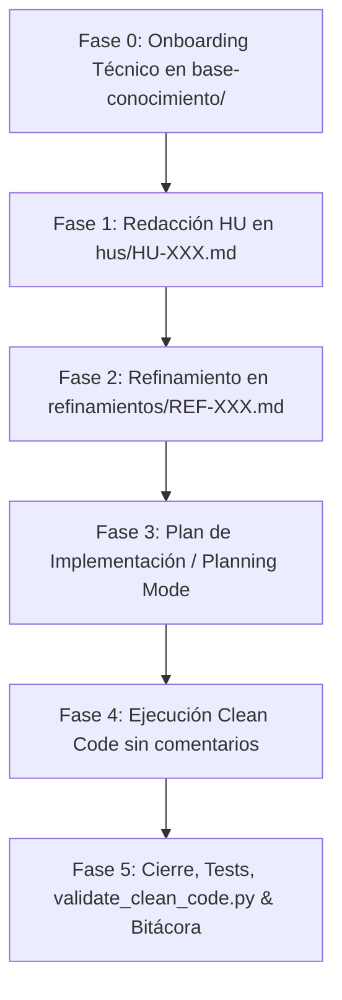

# 🤖 Skill: Metodología AI-First para Historias de Usuario

Esta skill guía a los Agentes de IA en el ciclo de vida completo de desarrollo de software ágil bajo una política **AI-First**, garantizando que el código sea auto-descriptivo, libre de comentarios redundantes y respaldado por pruebas automatizadas y documentación sincronizada.

---

## 🎯 Cuándo Activar esta Skill

Activa esta skill cuando el usuario solicite:
- **Onboarding de un proyecto existente (Brownfield / legacy / productivo)** o inicialización de la arquitectura de un nuevo repo.
- Iniciar, refinar o implementar una nueva **Historia de Usuario (HU)**.
- Crear especificaciones técnicas, contratos REST o diagramas de arquitectura.
- Refactorizar o auditar código bajo estándares estrictos de **Clean Code** (sin comentarios inline/bloques explicativos).
- Diseñar y ejecutar suites de pruebas automatizadas con umbrales de cobertura (*Coverage Gates*).

---

## ⚡ Slash Commands y Atajos Rápidos de Rol

Esta skill responde inmediatamente a los siguientes comandos por slash o menciones de rol:

| Comando | Rol Activado | Fase | Acción Ejecutada |
|---|---|---|---|
| **`/onboarding`** o `/lider-tecnico` | `TechLeadArchitect` | **Fase 0** | Escaneo del stack con `onboard_project.py` y generación de `base-conocimiento/`. |
| **`/nueva-hu`** o `/po-scrum` | `POScrum` | **Fase 1** | Captura requerimientos (soporta copiar/pegar de Azure DevOps/Jira), corre `scaffold_hu.py` y redacta Gherkin. |
| **`/refinar-hu`** | `TechLeadArchitect` | **Fase 2** | Modela flujo Mermaid, define DTOs/contratos y valida DDL/ORM en `refinamientos/REF-XXX.md`. |
| **`/desarrollar-hu`** | `DevQA` | **Fase 4** | Implementa código en Backend y Frontend bajo Clean Code estricto (**cero comentarios explicativos**). |
| **`/cerrar-hu`** o `/auditar-clean-code` | `DevQA` | **Fase 5** | Audita comentarios con `validate_clean_code.py`, ejecuta tests desatendidos, actualiza bitácora y marca `🟢 Finalizado`. |

---

## 🔄 Protocolo Operativo: Fase 0 + 5 Fases



### 🏛️ Fase 0: Onboarding Técnico & Descubrimiento (Rol: TechLeadArchitect)
*Al iniciar un proyecto existente o sin HUs previas:*
- Ejecutar el escaneo automático del stack:
  ```bash
  python scripts/onboard_project.py --path ./ --name "NombreDelSistema"
  ```
- El Líder Técnico documenta en `base-conocimiento/`:
  - `01-analisis-arquitectura.md` (Diagramas Mermaid y mapa de capas).
  - `02-estandares-desarrollo.md` (Convenciones y Clean Code).
  - `03-estandares-pruebas.md` (Coverage gates y comandos headless).
  - `04-dominio-negocio.md` (Entidades y reglas del negocio).
- Establecida la línea base, el Product Owner procede a la Fase 1.

### 🟡 Fase 1: Identificación y Redacción de la HU
- Usar el script de scaffolding para crear la estructura base:
  ```bash
  python scripts/scaffold_hu.py HU-XXX "Título de la Historia"
  ```
- O instanciar `templates/hu-template.md` en `hus/HU-XXX.md`.
- Redactar criterios de aceptación formales en **Gherkin** (*Dado / Cuando / Entonces*).
- Asignar estado inicial: `🟡 En Refinamiento`.

### 🔬 Fase 2: Refinamiento Técnico & Contratos
- Completar `refinamientos/REF-XXX.md` basándose en `templates/refinamiento-template.md`.
- Incluir diagrama de arquitectura o flujo de datos en sintaxis **Mermaid**.
- Especificar contratos DTO (JSON Request/Response) y métodos/servicios involucrados.
- **Validación de Persistencia y ORM**:
  - Validar compatibilidad entre el esquema de base de datos DDL y las entidades ORM (EF Core, JPA, etc.).
  - Asegurar ordenamiento unívoco en colecciones relacionales (ej. `.OrderBy()` o `@OrderBy`).
- Marcar estado como `🟢 Aprobado para Desarrollo`.

### 📐 Fase 3: Plan de Implementación (Planning Mode)
- Generar el plan técnico estructurado en `implementation_plan.md` si la HU involucra múltiples capas o cambios en persistencia.
- Solicitar aprobación humana antes de realizar modificaciones sobre el código fuente.

### 💻 Fase 4: Ejecución Clean Code Multilenguaje
- Implementar la solución en el stack tecnológico correspondiente (.NET C#, Java Spring, TypeScript Angular/React, Python, etc.).
- **Regla Estricta de Clean Code**:
  - Cero comentarios explicativos redundantes en clases, funciones o archivos de configuración.
  - El código debe comunicar su intención mediante nombres expresivos y métodos concisos.
  - Consulta [references/clean-code-rules.md](references/clean-code-rules.md) para patrones y comparativas.
- Separar vistas, estilos y lógica en archivos independientes.

### 🧪 Fase 5: Cierre, Verificación y Bitácora
- Ejecutar las suites de pruebas con banderas no interactivas:
  - C# / .NET: `dotnet test --no-restore`
  - Java: `mvn test` o `./gradlew test --no-daemon`
  - Frontend: `npm test -- --watch=false --browsers=ChromeHeadless`
  - Python: `pytest`
- Superar los *Coverage Gates* mínimos: **Backend $\ge 80\%$**, **Frontend $\ge 85\%$**.
- Ejecutar la auditoría automática de código limpio:
  ```bash
  python scripts/validate_clean_code.py --path ./src --strict
  ```
- Completar la bitácora individual en `dev-records/DEV-RECORD-HU-XXX.md`.
- Actualizar el estado de la HU y del Refinamiento a `🟢 Finalizado`.

---

## 📚 Recursos y Plantillas Vinculadas

- 📄 Plantilla HU: [`templates/hu-template.md`](templates/hu-template.md)
- 🔬 Plantilla Refinamiento: [`templates/refinamiento-template.md`](templates/refinamiento-template.md)
- 📝 Plantilla Bitácora: [`templates/dev-record-template.md`](templates/dev-record-template.md)
- 🧹 Reglas Clean Code: [`references/clean-code-rules.md`](references/clean-code-rules.md)
- 🔄 Flujo y Roles Scrum: [`references/ai-first-scrum-workflow.md`](references/ai-first-scrum-workflow.md)
- 🧪 Estándares de Testing: [`references/testing-standards.md`](references/testing-standards.md)
