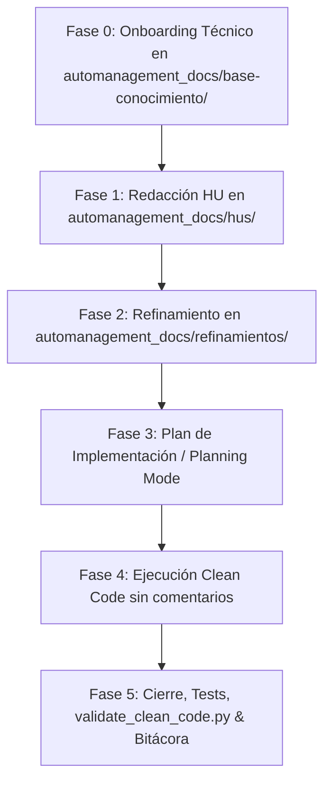

# 🤖 Skill: Metodología AI-First para Historias de Usuario

Esta skill guía a los Agentes de IA en el ciclo de vida completo de desarrollo de software ágil bajo una política **AI-First**, garantizando que el código sea auto-descriptivo, libre de comentarios redundantes y respaldado por pruebas automatizadas y documentación sincronizada.

---

## 🎯 Cuándo Activar esta Skill

Activa esta skill cuando el usuario solicite:
- **Onboarding de un proyecto existente (Brownfield / legacy / productivo)** o inicialización de la arquitectura de un nuevo repo.
- Iniciar, refinar o implementar una nueva **Historia de Usuario (HU)**.
- Crear especificaciones técnicas, contratos REST o diagramas de arquitectura.
- Refactorizar o auditar código bajo estándares estrictos de **Clean Code** (sin comentarios inline/bloques explicativos).
- Diseñar y ejecutar suites de pruebas automatizadas con umbrales de cobertura (*Coverage Gates*).

---

## ⚡ Slash Commands y Atajos Rápidos de Rol

Esta skill responde inmediatamente a los siguientes comandos por slash o menciones de rol:

| Comando | Rol Activado | Fase | Acción Ejecutada |
|---|---|---|---|
| **`/onboarding`** o `/lider-tecnico` | `TechLeadArchitect` | **Fase 0** | Escaneo del stack con `onboard_project.py` y generación de `automanagement_docs/base-conocimiento/`. |
| **`/nueva-hu`** o `/po-scrum` | `POScrum` | **Fase 1** | Captura requerimientos (soporta copiar/pegar de Azure/Jira). **Prohibido inventar la HU si no hay descripción: debe solicitarla al usuario.** |
| **`/refinar-hu`** | `TechLeadArchitect` | **Fase 2** | Modela flujo Mermaid, define DTOs/contratos y valida DDL/ORM en `automanagement_docs/refinamientos/REF-XXX.md`. |
| **`/desarrollar-hu`** | `DevQA` | **Fase 4** | Implementa código en Backend y Frontend bajo Clean Code estricto (**cero comentarios explicativos**). |
| **`/cerrar-hu`** o `/auditar-clean-code` | `DevQA` | **Fase 5** | Audita comentarios con `validate_clean_code.py`, ejecuta tests desatendidos, actualiza bitácora en `automanagement_docs/dev-records/` y marca `🟢 Finalizado`. |

---

## 🔄 Protocolo Operativo: Fase 0 + 5 Fases



### 🏛️ Fase 0: Onboarding Técnico & Descubrimiento (Rol: TechLeadArchitect)
*Al iniciar un proyecto existente o sin HUs previas:*
- **Ejecución del Escaneo**:
  ```bash
  python scripts/onboard_project.py --path <ruta_proporcionada_por_usuario> --name "NombreDelSistema"
  ```
- **🛑 Regla de Oro de Ruta y No Duplicación**:
  - Usa `--path` **exactamente con la ruta raíz indicada por el usuario** (o `./` si no especifica).
  - **PROHIBIDO MODIFICAR LA RUTA**: Nunca cambies `--path` a una subcarpeta interna de código (ej. nunca a `<ruta>/Administrador_Facturas` o `<ruta>/back_x`). El script ya escanea recursivamente todas las subcarpetas.
  - `automanagement_docs/` reside **exclusivamente en la raíz** del espacio de trabajo indicado, manteniéndose externa e independiente a las carpetas de código.
  - **PROHIBIDO TERMINANTEMENTE** duplicar, sincronizar, copiar (`Copy-Item`, `cp -r`) o crear uniones/enlaces simbólicos (`New-Item -ItemType Junction`) de `automanagement_docs/`. El script se encarga al 100% de la creación de la carpeta.
- El Líder Técnico documenta en `automanagement_docs/base-conocimiento/`:
  - `01-analisis-arquitectura.md` (Diagramas Mermaid y mapa de capas).
  - `02-estandares-desarrollo.md` (Convenciones y Clean Code).
  - `03-estandares-pruebas.md` (Coverage gates y comandos headless).
  - `04-dominio-negocio.md` (Entidades y reglas del negocio).
- Se genera el índice global `automanagement_docs/README.md` con la tabla central de seguimiento de HUs y reglas clave.
- **Auditoría de Higiene de Git**: Verificar que el `.gitignore` del repositorio contemple el stack detectado (.NET `bin/`/`obj/`, Java `target/`, Node `node_modules/`, Python `__pycache__`/`.pytest_cache`/`.coverage`) y archivos temporales de ejecución.
- Establecida la línea base, el Product Owner procede a la Fase 1.

### 🟡 Fase 1: Identificación y Redacción de la HU (Rol: POScrum)

> [!CAUTION]
> **🛑 REGLA ESTRICTA ANTI-ALUCINACIÓN (CONSULTA OBLIGATORIA)**:  
> Si el usuario ejecuta `/nueva-hu` o `/nueva-hu [ID]` **sin adjuntar una descripción, título o texto de requerimiento**, el agente **TIENE ESTRICTAMENTE PROHIBIDO INVENTAR O ASUMIR** la funcionalidad de la Historia de Usuario.  
> 
> En este caso, el agente **NO debe ejecutar `scaffold_hu.py` todavía**. Debe detenerse y responder solicitando al usuario:
> 1. El objetivo o enfoque de la funcionalidad (o pedir que pegue la tarea copiada de Azure DevOps / Jira).
> 2. El rol o usuario principal que se beneficia (*Como...*).
> 3. Criterios de aceptación o reglas de negocio clave que espera validar.

- **Flujo de Ejecución (Solo tras tener la información del usuario)**:
  1. Extraer ID y título formal de la historia.
  2. Ejecutar el script de scaffolding:
     ```bash
     python scripts/scaffold_hu.py HU-XXX "Título de la Historia"
     ```
     *(El script genera exclusivamente `automanagement_docs/hus/HU-XXX.md` y registra la historia como 🟡 En Refinamiento en el índice central).*
  3. Editar `automanagement_docs/hus/HU-XXX.md` estructurando los criterios de aceptación formales en **Gherkin** (*Dado / Cuando / Entonces*), cubriendo escenario feliz y manejo de errores.
  4. Asignar estado inicial: `🟡 En Refinamiento`.
  5. Invitar al usuario a continuar con `/refinar-hu HU-XXX`.

### 🔬 Fase 2: Refinamiento Técnico & Contratos (Rol: TechLeadArchitect)
- Crear el documento técnico `automanagement_docs/refinamientos/REF-XXX.md` adaptado 100% al paradigma real del proyecto (Desktop GUI, Web API, CLI, Microservicio) documentado en `base-conocimiento/`:
  - **Diagrama Mermaid**: Modela el flujo real (si es Desktop, eventos de ventana/widgets, controladores y archivos; si es API, clientes, endpoints y BD).
  - **Modelos y Contratos**: Clases y DTOs en el lenguaje nativo del proyecto (`dataclass` en Python, `record` en C#, etc.). **Prohibido forzar contratos Web/REST si la aplicación es de escritorio**.
  - **Integridad y Respeto a Plantillas Preexistentes**: Si el sistema genera documentos o correos desde plantillas preexistentes (binarios `.docx`/`.xlsx`/`.pdf`, correos `.html`/`.mjml`, archivos planos `.txt`/`.csv`), el arquitecto debe auditar los campos y variables exactos de la plantilla. **Queda prohibido asumir cambios de estructura en la plantilla** sin aprobación explícita; la capa adaptadora debe suministrar exactamente las variables esperadas por la plantilla actual.
  - **Persistencia y Almacenamiento**: Archivos locales (JSON, plantillas) o bases de datos según aplique.
  - **Casos Borde y Validaciones**: Manejo controlado de excepciones.
  - **Checklist Técnico**: Tareas ordenadas para la Fase 4 de desarrollo.
- Actualizar el enlace y estado en `automanagement_docs/hus/HU-XXX.md` y en `automanagement_docs/README.md` a `🟢 Aprobado para Desarrollo`, enlazando `[`REF-XXX.md`](../refinamientos/REF-XXX.md)`.

### 📐 Fase 3: Plan de Implementación (Planning Mode)
- Generar el plan técnico estructurado en `implementation_plan.md` si la HU involucra múltiples capas o cambios en persistencia.
- Solicitar aprobación humana antes de realizar modificaciones sobre el código fuente.

### 💻 Fase 4: Ejecución Clean Code Multilenguaje
- Implementar la solución en el stack tecnológico correspondiente (.NET C#, Java Spring, TypeScript Angular/React, Python, etc.).
- **Regla Estricta de Clean Code**:
  - Cero comentarios explicativos redundantes en clases, funciones o archivos de configuración.
  - El código debe comunicar su intención mediante nombres expresivos y métodos concisos.
  - Consulta [references/clean-code-rules.md](references/clean-code-rules.md) para patrones y comparativas.
- Separar vistas, estilos y lógica en archivos independientes.
- **Fidelidad a Plantillas**: Mapear estrictamente las variables y estructuras que la plantilla espera, preservando la compatibilidad sin modificar archivos binarios o layouts predefinidos.

### 🧪 Fase 5: Cierre, Verificación y Bitácora
- Ejecutar las suites de pruebas con banderas no interactivas:
  - C# / .NET: `dotnet test --no-restore`
  - Java: `mvn test` o `./gradlew test --no-daemon`
  - Frontend: `npm test -- --watch=false --browsers=ChromeHeadless`
  - Python: `pytest`
- Superar los *Coverage Gates* mínimos: **Backend $\ge 80\%$**, **Frontend $\ge 85\%$** (excluyendo entrypoints o UI según `references/testing-standards.md`).
- Ejecutar la auditoría automática de código limpio:
  ```bash
  python scripts/validate_clean_code.py --path ./src --strict
  ```
- **Auditoría de Higiene Git**: Ejecutar `git status` para comprobar que ningún archivo temporal, build o caché de pruebas quede sin ignorar en el `.gitignore`.
- Completar la bitácora individual en `automanagement_docs/dev-records/DEV-RECORD-HU-XXX.md`.
- Actualizar el estado de la HU, del Refinamiento y de la tabla central en `automanagement_docs/README.md` a `🟢 Finalizado`.

---

## 📚 Recursos y Plantillas Vinculadas

- 📄 Plantilla HU: [`templates/hu-template.md`](templates/hu-template.md)
- 🔬 Plantilla Refinamiento: [`templates/refinamiento-template.md`](templates/refinamiento-template.md)
- 📝 Plantilla Bitácora: [`templates/dev-record-template.md`](templates/dev-record-template.md)
- 🧹 Reglas Clean Code: [`references/clean-code-rules.md`](references/clean-code-rules.md)
- 🔄 Flujo y Roles Scrum: [`references/ai-first-scrum-workflow.md`](references/ai-first-scrum-workflow.md)
- 🧪 Estándares de Testing: [`references/testing-standards.md`](references/testing-standards.md)
