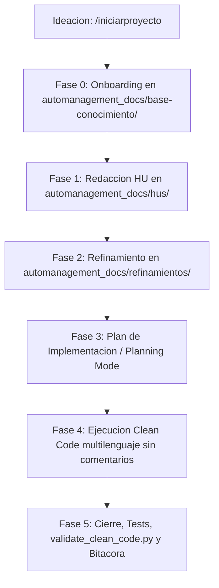

# Metodología AI-First para Historias de Usuario (Multilenguaje)

Esta skill guía a los Agentes de IA en el ciclo de vida de desarrollo de software ágil bajo política **AI-First** de manera **estrictamente multilenguaje** (.NET C#, Java Spring Boot, TypeScript/JavaScript/Node/Angular/React, Go, Rust, PHP, Python, etc.), garantizando código auto-descriptivo sin comentarios redundantes, pruebas automatizadas y documentación sincronizada en `automanagement_docs/`.

---

## Cuándo Activar esta Skill

Activa esta skill cuando el usuario solicite:
- Iniciar o idear un proyecto nuevo desde cero (Greenfield / sin código) con `/iniciarproyecto`.
- Onboarding de un proyecto existente (Brownfield / legacy / productivo) o inicialización de arquitectura en cualquier ecosistema (.NET, Java, TS, Go, Rust, PHP, Python).
- Iniciar, refinar o implementar una Historia de Usuario (HU).
- Reportar o corregir un defecto o bug con pruebas de regresión automáticas.
- Consultar, auditar o conversar sobre una Historia de Usuario existente (`/chat-hu`).
- Consultar el tablero de métricas y KPIs locales (`/kpis`).
- Crear especificaciones técnicas, contratos REST o diagramas Mermaid.
- Refactorizar o auditar código bajo Clean Code estricto (0 comentarios inline/bloques explicativos en cualquier lenguaje admitido).
- Diseñar y ejecutar suites de pruebas automatizadas con Coverage Gates (Backend >= 80%, Frontend >= 85%) bajo patrón AAA y Data Builders.

---

## Slash Commands y Roles

| Comando | Rol Activado | Fase / Ámbito | Acción Ejecutada |
|---|---|---|---|
| `/iniciarproyecto` | `CTO` / `TechAdvisor` | Ideación / Greenfield | Calibra perfil (técnico/no técnico), idea y ruta; chequea entorno, orquesta CLI oficial y crea `automanagement_docs/`. |
| `/onboarding` o `/lider-tecnico` | `TechLeadArchitect` | Fase 0 | Escaneo del stack con `onboard_project.py` y generación de `automanagement_docs/base-conocimiento/`. |
| `/nueva-hu` o `/po-scrum` | `POScrum` | Fase 1 | Captura requerimientos con **Regla Anti-Alucinación estricta**. |
| `/refinar-hu` | `TechLeadArchitect` | Fase 2 | Modela flujo Mermaid, define DTOs/contratos y valida persistencia en `automanagement_docs/refinamientos/REF-XXX.md`. |
| `/desarrollar-hu` | `DevQA` | Fase 4 | Implementa código bajo Clean Code estricto (**cero comentarios explicativos** en cualquier lenguaje). |
| `/cerrar-hu` o `/auditar-clean-code` | `DevQA` | Fase 5 | Audita comentarios con `validate_clean_code.py` (con `--only-diff` en proyectos legacy), ejecuta tests desatendidos, genera bitácora y marca `[Finalizado]`. |
| `/reportar-bug` | `POScrum` / `DevQA` | Calidad QA | Registra formalmente un defecto con **Regla Anti-Alucinación** en `automanagement_docs/bugs/`. |
| `/corregir-bug` | `DevQA` | Calidad QA | Diagnostica RCA, crea prueba de regresión obligatoria, corrige con Clean Code y marca `[Resuelto]`. |
| `/kpis` o `/metricas` | Todos | Monitoreo | Ejecuta `show_metrics.py` y muestra el dashboard en 0.02s con **cero consumo de tokens IA**. |
| `/chat-hu` | Especialista 360° | Auditoría | Consulta, audita y explica una HU leyendo quirúrgicamente su tríada documental en `automanagement_docs/`. |

---

## Protocolo Operativo

> [!TIP]
> **[ENTORNOS SANDBOX Y EJECUCIÓN MULTICARPETAS]**:
> Si la ruta del proyecto proporcionada por el usuario reside fuera del espacio de trabajo activo o en particiones con restricciones de lectura/escritura (ej. entornos Linux Mint / Ubuntu con sandbox):
> 1. Asegura permisos de escritura en la ruta destino o habilita `BypassSandbox: true` si la herramienta de ejecución lo requiere.
> 2. Posiciona el directorio de trabajo (`Cwd`) directamente en la raíz del repositorio objetivo para garantizar la ejecución correcta de scripts y suites de pruebas.



### Fase de Ideación & Creación Greenfield (Rol: CTO / TechAdvisor - `/iniciarproyecto`)

Aplica cuando el usuario desea crear un proyecto desde cero sin base de código previa:

1. **Calibración Inicial en 1 Mensaje**:
   Si el usuario no proporcionó detalles, solicitar:
   - **Perfil**: `[1]` No Técnico / Negocio vs `[2]` Técnico / Desarrollador.
   - **Idea / Visión**: Problema a resolver o funcionalidades deseadas.
   - **Ruta Destino**: Carpeta actual (`./`) o subcarpeta.
2. **Asesoría Adaptativa**:
   - **No Técnico**: Explicación en lenguaje humano, recomendación de stack por valor/coste y propuesta de MVP en 2-3 HUs iniciales.
   - **Técnico**: Debate de estilos de arquitectura (Clean, Hexagonal), capas, contratos y herramientas de testing (AAA + Data Builder). Si el desarrollador solicita ayuda para elegir el stack tecnológico, realiza un **análisis técnico de trade-offs** (rendimiento, concurrencia, ecosistema, tipado, facilidad de testing) comparando 2 o 3 opciones viables con recomendación fundamentada.
3. **Pre-flight Environment Check**:
   - Ejecutar en segundo plano comandos de comprobación en terminal (`node -v`, `dotnet --version`, `python --version`, etc.) para verificar que el usuario tenga los compiladores y runtimes necesarios para compilar y probar por sí mismo.
4. **Orquestación de CLIs Oficiales & Base de Conocimiento**:
   - Ejecutar generadores oficiales si aplica (`npx @nestjs/cli new`, `npx @angular/cli new`, `dotnet new`, etc.) en modo desatendido.
   - Inicializar `automanagement_docs/base-conocimiento/` (`01` al `04`), `.gitignore` y matriz `README.md`.
   - Orientar al usuario a iniciar la primera funcionalidad con `/nueva-hu HU-001`.

### Fase 0: Onboarding Técnico & Descubrimiento (Rol: TechLeadArchitect)
- **Ejecución del Escaneo Multilenguaje**:
  ```bash
  python scripts/onboard_project.py --path <ruta_proporcionada_por_usuario> --name "NombreDelSistema"
  ```
  *(Soporta indistintamente `--path` o `--target-dir` y detecta automáticamente subcarpetas con repositorios Git o descriptores de stack).*
- **Regla de Oro de Ruta y No Duplicación**:
  - Usa `--path` con la ruta raíz indicada por el usuario (o `./`). Nunca apuntes a subcarpetas internas de código.
  - `automanagement_docs/` reside exclusivamente en la raíz del espacio de trabajo. Prohibido duplicar, sincronizar o crear uniones simbólicas.
- Documentar en `automanagement_docs/base-conocimiento/`:
  - `01-analisis-arquitectura.md` (Diagramas Mermaid y mapa de capas).
  - `02-estandares-desarrollo.md` (Convenciones y Clean Code multilenguaje).
  - `03-estandares-pruebas.md` (Coverage gates y comandos headless por ecosistema).
  - `04-dominio-negocio.md` (Entidades y reglas del negocio).
- Genera `automanagement_docs/README.md` con la tabla de seguimiento. Audita higiene de Git (`.gitignore`).

### Fase 1: Identificación y Redacción de la HU (Rol: POScrum)

> [!CAUTION]
> **[REGLA ANTI-ALUCINACIÓN ESTRICTA]**:
> Si el usuario ejecuta `/nueva-hu` o `/nueva-hu [ID]` **sin adjuntar una descripción o requerimiento**, el agente **TIENE PROHIBIDO INVENTAR O ASUMIR** la historia.
> Detenerse inmediatamente y solicitar:
> 1. Objetivo de la funcionalidad (o tarea de Azure DevOps / Jira).
> 2. Rol o actor principal (*Como...*).
> 3. Criterios de aceptación o reglas de negocio clave.

- **Flujo**:
  1. Con la información confirmada, ejecutar:
     ```bash
     python scripts/scaffold_hu.py HU-XXX "Título de la Historia"
     ```
  2. Editar `automanagement_docs/hus/HU-XXX.md` estructurando criterios de aceptación en formato **Gherkin** (*Dado / Cuando / Entonces*).
  3. Asignar estado `[En Refinamiento]`. Invitar a continuar con `/refinar-hu HU-XXX`.

### Fase 2: Refinamiento Técnico & Contratos (Rol: TechLeadArchitect)
- Crear `automanagement_docs/refinamientos/REF-XXX.md` adaptado a la arquitectura real (Desktop GUI, Web API, CLI, Microservicio):
  - **Diagrama Mermaid**: Modela el flujo real de interacción.
  - **Modelos y Contratos**: Clases/DTOs en el lenguaje nativo del proyecto (.NET C# Records/DTOs, Java POJOs/Records, TypeScript Interfaces, Go Structs, Rust Structs, etc.).
  - **Integridad de Plantillas**: Si consume plantillas binarias (`.docx`/`.xlsx`/`.pdf`), vistas (`.html`/`.mjml`) o planas (`.txt`/`.csv`), auditar marcadores y variables existentes. Prohibido asumir cambios en la estructura de plantillas sin aprobación.
  - **Casos Borde y Validaciones**: Manejo controlado de excepciones.
  - **Checklist Técnico**: Tareas ordenadas para desarrollo.
- Actualizar estado a `[Aprobado para Desarrollo]` en `HU-XXX.md` y `automanagement_docs/README.md`.

### Fase 3: Plan de Implementación (Planning Mode)
- Generar `implementation_plan.md` si la HU involucra múltiples capas o cambios en persistencia. Solicitar aprobación antes de modificar código.

### Fase 4: Ejecución Clean Code Multilenguaje (Rol: DevQA)
- Implementar en el stack correspondiente (.NET C#, Java Spring, TypeScript, Go, Rust, PHP, Python, etc.).
- **Regla Estricta Clean Code**: Cero comentarios explicativos redundantes. Código 100% auto-descriptivo en cualquier lenguaje.
- **Diseño de Tests (Patrón AAA y Data Builders)**: Estructurar todas las pruebas bajo el patrón **AAA (Arrange, Act, Assert)** con separación visual limpia y emplear **Data Builders** para fixtures o entidades complejas con 3 o más propiedades.
- **Fidelidad a Plantillas**: Mapear estrictamente los datos a las plantillas preexistentes.

### Fase 5: Cierre, Verificación y Bitácora (Rol: DevQA)
- Ejecutar tests con flags desatendidos según el ecosistema:
  - **.NET (C#)**: `dotnet test --no-restore --verbosity normal`
  - **Java**: `mvn clean test -DinteractiveMode=false` / `./gradlew test --no-daemon`
  - **TypeScript / Node / Frontend**: `npm test -- --watch=false` / `jest --ci` / `vitest run`
  - **Go**: `go test -v ./...`
  - **Rust**: `cargo test -- --nocapture`
  - **Python**: `pytest` (o fallback nativo sin dependencias: `python -m unittest discover -s tests -v`)
- Superar Coverage Gates: Backend >= 80%, Frontend >= 85%.
- Auditar Clean Code:
  ```bash
  # Proyecto greenfield / nuevo:
  python scripts/validate_clean_code.py --path ./src --strict
  # Proyecto brownfield / legacy (audita exclusivamente líneas modificadas de la HU):
  python scripts/validate_clean_code.py --path ./src --strict --only-diff
  ```
- Verificar higiene Git (`git status`).
- Completar bitácora en `automanagement_docs/dev-records/DEV-RECORD-HU-XXX.md`.
- Actualizar HU, Refinamiento y `README.md` a `[Finalizado]`.

---

## Gestión de Defectos y Métricas de Calidad

### Reporte de Defectos (`/reportar-bug`)
- **Regla Anti-Alucinación**: Solicitar comportamiento observado vs. esperado, pasos/logs, HU asociada y severidad (`[Bloqueante]`, `[Alta]`, `[Media]`, `[Baja]`).
- Ejecutar: `python scripts/scaffold_bug.py BUG-XXX-01 "Título del Defecto" --hu HU-XXX --severity Alta`

### Corrección de Defectos (`/corregir-bug`)
- Realizar análisis RCA (archivo y línea exacta).
- **Regression Test Gate Obligatorio**: Crear prueba automatizada en `tests/` que reproduzca el fallo antes de darlo por corregido.
- Corregir con Clean Code, verificar suite completa y marcar `[Resuelto]`.

### Tablero de Métricas Locales (`/kpis`)
- Ejecuta `python scripts/show_metrics.py` en 0.02s con **0 tokens de IA** y 100% de privacidad local.

### Consulta y Chat de Historias de Usuario (`/chat-hu [HU-ID]`)
- **Soporte Flexible de IDs**: Admite formatos estándar (`HU-001`), Azure DevOps (`607340`, `US-607340`) o Jira (`PROJ-123`).
- **Carga Quirúrgica de Contexto**: Lee exclusivamente `automanagement_docs/hus/HU-XXX.md`, `refinamientos/REF-XXX.md`, `dev-records/DEV-RECORD-HU-XXX.md` y bugs asociados.
- **Inspección de Código Puntual**: Si el usuario proporciona una ruta o solicita auditar código puntual, inspecciona ese archivo específico para contrastarlo contra los requerimientos y el refinamiento de la HU.
- **Respuesta Multirrol Especializada**:
  - Responde como `POScrum` para alcance, negocio o criterios Gherkin.
  - Responde como `TechLeadArchitect` para contratos, DTOs, diagramas Mermaid o persistencia.
  - Responde como `DevQA` para archivos modificados, suites de prueba y métricas de cobertura.
- **Trazabilidad y Cero Alucinaciones**: Cita siempre el documento fuente (`[REF-XXX.md]`, `[HU-XXX.md]`) y archivo/línea de código si fue inspeccionado. Si algo no fue contemplado, lo declara abiertamente sin inventar.

---

## Recursos y Plantillas Vinculadas

- Plantilla HU: [`templates/hu-template.md`](templates/hu-template.md)
- Plantilla Bug: [`templates/bug-template.md`](templates/bug-template.md)
- Plantilla Refinamiento: [`templates/refinamiento-template.md`](templates/refinamiento-template.md)
- Plantilla Bitácora: [`templates/dev-record-template.md`](templates/dev-record-template.md)
- Reglas Clean Code: [`references/clean-code-rules.md`](references/clean-code-rules.md)
- Flujo y Roles Scrum: [`references/ai-first-scrum-workflow.md`](references/ai-first-scrum-workflow.md)
- Estándares Testing: [`references/testing-standards.md`](references/testing-standards.md)
