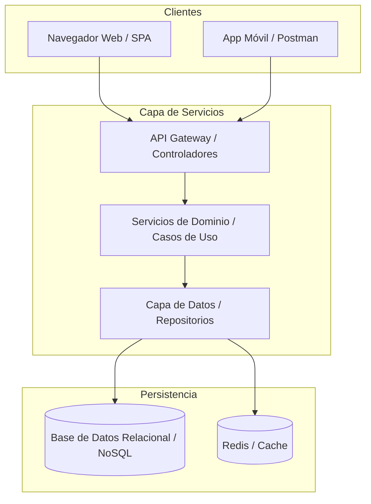

# Análisis de Arquitectura del Sistema: [Nombre del Proyecto]

| Campo | Detalles |
|---|---|
| **Proyecto** | [Nombre del Sistema / Repositorio] |
| **Fecha de Onboarding** | YYYY-MM-DD |
| **Líder Técnico / Agente**| [TechLeadArchitect] |
| **Tipo de Sistema** | [Monolito Modular / Microservicios / Clean Architecture / API REST / etc.] |
| **Estado de Documentación**| [En Construcción] / [Línea Base Establecida] |

---

## 1. Visión General del Sistema y Contexto
Breve descripción de qué hace la aplicación, usuarios objetivo y propósito del software.

---

## 2. Stack Tecnológico y Ecosistema Detectado

- **Backend:** [Ej. C# .NET 8, Spring Boot 3, FastAPI, NestJS]
- **Frontend:** [Ej. Angular 17, React 18, Blazor, Razor Pages, Vue]
- **Persistencia / Base de Datos:** [Ej. PostgreSQL, SQL Server, MongoDB, SQLite]
- **Herramientas de Build & Runtimes:** [Ej. .NET SDK, Maven, Gradle, Node/NPM, Docker]

---

## 3. Diagrama de Arquitectura de Alto Nivel (Mermaid)



---

## 4. Mapa de Directorios y Organización de Capas

```text
[Ruta Raíz del Repositorio]
├── src/ / backend/                     # Código fuente de servidor
│   ├── Controllers / Endpoints         # Puntos de entrada HTTP / gRPC
│   ├── Application / UseCases          # Lógica de aplicación y orquestación
│   ├── Domain / Models                 # Entidades nucleares y reglas de negocio
│   └── Infrastructure / Persistence    # Acceso a datos, integraciones externas
├── frontend/ / client/                 # Aplicación de usuario / interfaz
└── tests/                              # Suites de pruebas automatizadas
```

---

## 5. Catálogo de Puntos de Entrada y Servicios Existentes

| Módulo / Controlador | Ruta Base / Endpoint | Descripción / Responsabilidad |
|---|---|---|
| [Ej. AuthController] | `/api/v1/auth` | Login, emisión de JWT y renovación de tokens |
| [Ej. MediaController] | `/api/v1/media` | Consulta y gestión de contenido multimedia |
| [Ej. StreamController] | `/api/v1/stream` | Transmisión de video con soporte HTTP 206 Partial Content |

---

## 6. Puntos Críticos y Deuda Técnica Detectada
- **Punto 1:** [Ej. Ausencia de migraciones DDL automatizadas o inconsistencia con ORM].
- **Punto 2:** [Ej. Falta de ordenamiento explícito en colecciones hijas].
- **Punto 3:** [Ej. Comentarios redundantes en código heredado pendientes de refactorización].
