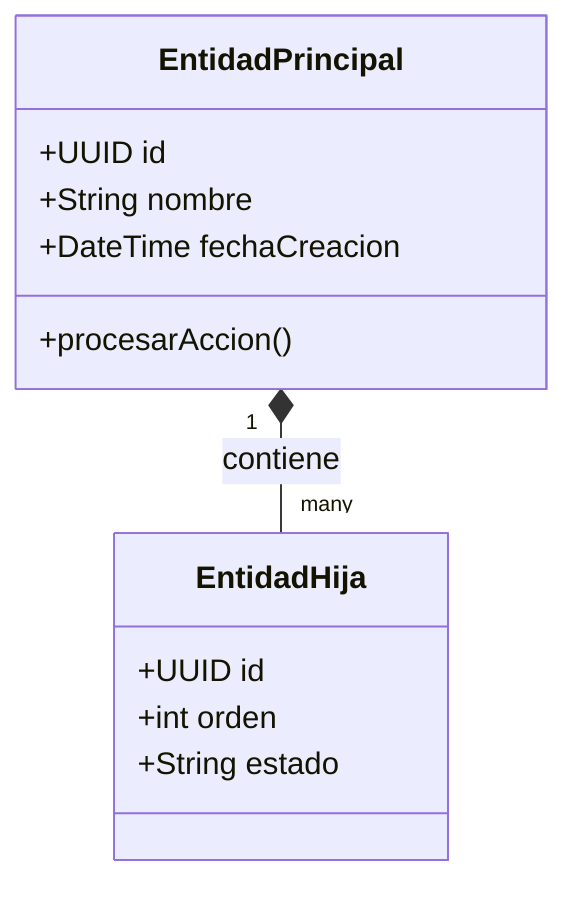

# 💼 Dominio de Negocio y Reglas Operativas

| Campo | Detalles |
|---|---|
| **Proyecto** | [Nombre del Sistema] |
| **Fecha de Revisión** | YYYY-MM-DD |
| **Líder Técnico** | [TechLeadArchitect] |

---

## 🧭 1. Propósito del Negocio
Descripción del problema que resuelve la aplicación, propuesta de valor y actores principales.

---

## 🧩 2. Entidades Principales del Dominio

- **Entidad A:** [Descripción de su rol en el negocio].
- **Entidad B:** [Descripción de su rol en el negocio].

---

## 📜 3. Reglas de Negocio Inmutables (Invariants)
1. **Regla 1:** [Ej. Un pedido no puede pasar a estado 'Enviado' sin un pago previamente aprobado].
2. **Regla 2:** [Ej. Si un episodio no tiene marcas de Skip Intro propias, hereda las marcas por defecto de su temporada].
3. **Regla 3:** [Ej. Las operaciones de importación masiva deben ser idempotentes ante reintentos].

---

## 🗺️ 4. Glosario de Términos Ubicuos
- **Término A**: Definición clara y consensuada entre el equipo técnico y de negocio.
- **Término B**: Definición clara para evitar malentendidos en nombres de clases y endpoints.
