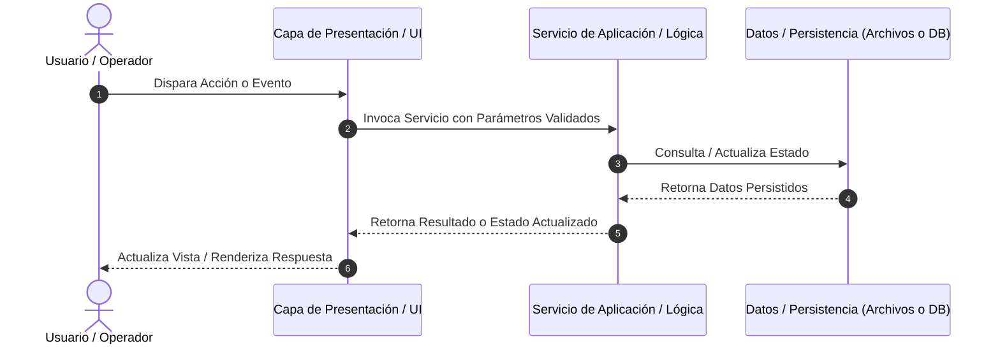

# Análisis de Refinamiento Técnico: [REF-XXX] - [Título de la HU]

| Campo | Detalles |
|---|---|
| **Historia Asociada** | [`HU-XXX.md`](../hus/HU-XXX.md) |
| **Fecha de Refinamiento**| YYYY-MM-DD |
| **Estado** | [En Análisis] / [Aprobado para Desarrollo] |
| **Paradigma / Arquitectura** | [Desktop GUI (Tkinter/WPF/Electron) / Web API / CLI / Frontend SPA / etc.] |
| **Módulos Afectados** | [Capa de Dominio, Repositorio, Servicios, Vistas, etc.] |

---

## 1. Arquitectura y Diagrama de Flujo (Mermaid)

*El Líder Técnico debe modelar el flujo de interacción adaptado al tipo de aplicación:*
- **Si es Aplicación de Escritorio (Desktop/GUI):** Modela la interacción entre Eventos de la UI (Ventana/Widgets), Servicios de Aplicación, Controladores locales y Archivos en disco.
- **Si es Web / API:** Modela la secuencia entre Navegador/Cliente, Endpoints REST/GraphQL, Servicios de Negocio y Base de Datos.
- **Si es CLI / Script / Worker:** Modela el pipeline de entrada de argumentos, procesamiento y salida de resultados.

---

## 2. Modelos de Dominio, Interfaces y Contratos

*Especifica los modelos y estructuras tipadas en el lenguaje de programación real del proyecto (.NET C#, Python, TypeScript, Java, etc.):*

### 2.1 Modelos de Datos / DTOs
- Define clases, interfaces o estructuras (`dataclass` en Python, `record` en C#, `interface` en TypeScript, `record/class` en Java).
- Nombres explícitos, tipos de datos concretos y propiedades inmutables cuando aplique.

### 2.2 Contratos de Interfaz o Endpoints
- **Si es Desktop / CLI:** Especifica las firmas de métodos públicos de los servicios (parámetros de entrada, tipos de retorno y excepciones esperadas).
- **Si es Web / API:** Especifica los endpoints HTTP (Ruta, Método, Headers, Request JSON y Response JSON).

---

## 3. Almacenamiento, Persistencia y Contratos de Plantillas

*Valida la persistencia y manipulación de archivos según la naturaleza del proyecto:*
- **Archivos Locales / Estáticos (JSON, XML, CSV, SQLite):** Valida esquemas de datos, encoding UTF-8 y resolución segura de rutas absolutas mediante librerías del sistema (`pathlib.Path` en Python, `System.IO.Path` en .NET, `java.nio.file.Path` en Java).
- **Bases de Datos Relacionales / ORM (SQL, EF Core, JPA):** Valida restricciones de esquema (`NOT NULL`, llaves foráneas) y ordenamiento unívoco en colecciones hijas (`@OrderBy` o `.OrderBy()`).

### 3.1 Integridad y Respeto a Plantillas Preexistentes
*Aplica obligatoriamente si el sistema consume o genera archivos a partir de plantillas del repositorio:*
- **Plantillas de Documentos Binarios (.docx, .xlsx, .pdf):** Audita minuciosamente los marcadores, campos de formulario y nombres de variables existentes en el archivo binario (ej. variables numeradas, tags). **Queda estrictamente prohibido asumir cambios de estructura en el binario sin autorización explícita del usuario**; la capa adaptadora debe mapear sus datos estrictamente al esquema esperado por la plantilla existente.
- **Plantillas de Correos y Vistas (.html, .mjml, .razor, .jsp, .j2):** Inspecciona los tags de interpolación requeridos y respeta la jerarquía visual y de estilos original.
- **Plantillas de Archivos Planos (.txt, .csv, .tsv):** Preserva el orden exacto de columnas, delimitadores (coma, punto y coma, tabulador) y saltos de línea requeridos por los sistemas consumidores.

---

## 4. Casos Borde y Manejo de Errores

| Escenario / Caso Borde | Estrategia de Mitigación / Comportamiento |
|---|---|
| **Datos de entrada inválidos o incompletos** | Validación temprana con mensaje descriptivo; previene corrupción de estado. |
| **Recurso o archivo no encontrado** | Manejo controlado de excepciones sin volcado de stack trace al usuario. |
| **Colisión de concurrencia o archivo bloqueado** | Detección preventiva, sufijos correlativos o mensajes de reintento. |

---

## 5. Checklist de Tareas de Implementación (Fase 4 - DevQA)

- [ ] **Tarea 1 (Dominio):** Crear o actualizar los modelos y reglas de cálculo en la capa de dominio.
- [ ] **Tarea 2 (Persistencia):** Implementar la capa de datos o manejo de archivos con rutas seguras.
- [ ] **Tarea 3 (Servicios):** Implementar la lógica de negocio y casos de uso sin acoplamiento.
- [ ] **Tarea 4 (Presentación / UI):** Diseñar o integrar los componentes visuales / controladores requeridos.
- [ ] **Tarea 5 (Testing):** Crear las pruebas automatizadas bajo el patrón **AAA** y **Data Builders** requeridos para superar los Coverage Gates (Backend >= 80%, Frontend >= 85%).
- [ ] **Tarea 6 (Clean Code):** Auditar con `validate_clean_code.py` garantizando 0 comentarios redundantes.
