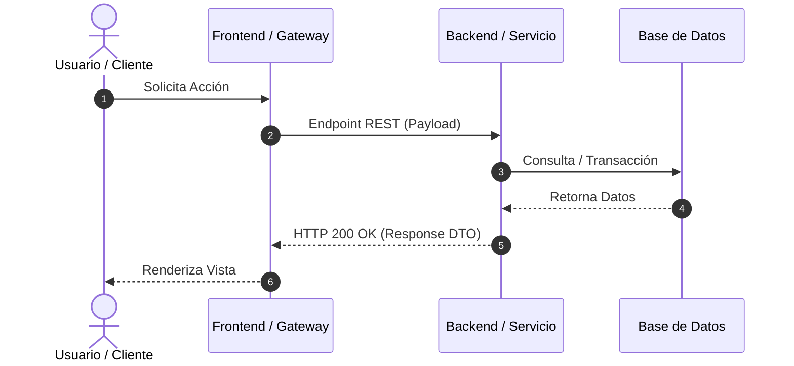

# 🔬 Análisis de Refinamiento Técnico: [REF-XXX] - [Título de la HU]

| Campo | Detalles |
|---|---|
| **Historia Asociada** | [`HU-XXX.md`](../hus/HU-XXX.md) |
| **Fecha de Refinamiento**| YYYY-MM-DD |
| **Estado** | 🟡 En Análisis / 🟢 Aprobado para Desarrollo |
| **Módulos Afectados** | [Backend / Frontend / Base de Datos / Infraestructura] |

---

## 🏗 1. Arquitectura y Diagrama de Flujo (Mermaid)



---

## 📐 2. Esquemas de Datos y Contratos de API

### 2.1 Modelos / Interfaces / DTOs
```typescript
// Contrato de Entrada (Request)
interface RequestDto {
  id: string;
  nombre: string;
}

// Contrato de Salida (Response)
interface ResponseDto {
  exito: boolean;
  mensaje: string;
}
```

### 2.2 Endpoints REST / RPC
- **Método**: `POST /api/v1/recurso`
- **Headers**: `Content-Type: application/json`
- **Request Body**:
```json
{
  "campo": "valor"
}
```
- **Response Exitosa (HTTP 200/201)**:
```json
{
  "resultado": "ok"
}
```

---

## 🗄 3. Base de Datos y Persistencia (DDL vs ORM)
- [ ] **Validación de Schema**: Verificar que columnas requeridas (`NOT NULL`) y tipos coincidan exactamente entre entidades ORM (JPA/EF Core) y scripts de migración DDL.
- [ ] **Ordenamiento Explícito**: Garantizar que listas o colecciones relacionales tengan criterio de ordenamiento unívoco (ej. `@OrderBy("ordinal ASC")` en JPA o `.OrderBy(x => x.Orden)` en EF Core).

---

## ⚠️ 4. Casos Borde y Manejo de Errores
- **Caso Borde 1:** [Condición límite o recurso no encontrado] -> *Estrategia: HTTP 404 / Excepción de Dominio controlada.*
- **Caso Borde 2:** [Falla de timeout o concurrencia] -> *Estrategia: Reintento / Bloqueo optimista.*

---

## 📋 5. Checklist de Tareas de Implementación
- [ ] Tarea 1: Definir modelos de dominio y DTOs.
- [ ] Tarea 2: Implementar capa de persistencia / migraciones.
- [ ] Tarea 3: Implementar lógica de negocio y casos de uso.
- [ ] Tarea 4: Exponer controladores / endpoints REST.
- [ ] Tarea 5: Construir o integrar componentes de interfaz gráfica (si aplica).
- [ ] Tarea 6: Escribir suites de pruebas automatizadas.
- [ ] Tarea 7: Auditar código con `validate_clean_code.py`.
- [ ] Tarea 8: Registrar bitácora en `dev-records/DEV-RECORD-HU-XXX.md`.
